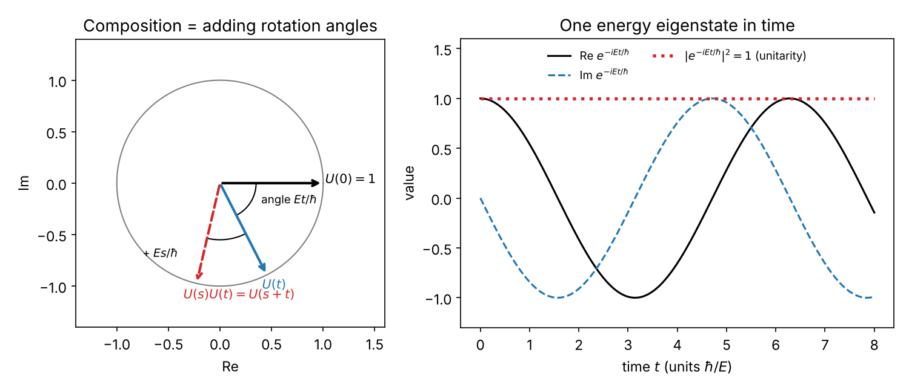
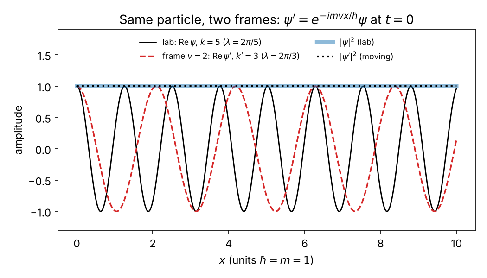

<!-- strategy: Boosted matter waves -->

Fire electrons at a nickel crystal and they land in the pattern of a wave with wavelength $h/p$; put neutrons through a silicon interferometer and their phase shifts by (energy difference × time)/$\hbar$; those two facts, plus a few general assumptions and Galilean invariance, pin down the Schrödinger equation. Every step below is labelled *assumption*, *theorem* (follows from what precedes), or *heuristic*.

## 1. Experiments

**Davisson–Germer (1927).** Electrons accelerated through a voltage $V_0$ (54 V in the famous run) hit a nickel crystal. *Observed:* the collected current versus angle has a sharp peak (near 50°) close to where a wave of wavelength $\lambda = h/p$ would be Bragg-reflected by the crystal planes, $p$ being the momentum from $V_0$; the match becomes quantitative once refraction by the crystal's inner potential is included. Raising $V_0$ shrinks $\lambda \propto 1/\sqrt{V_0}$ and so moves the peak (Bragg: $\sin\theta \propto \lambda$). Idealization: monoenergetic beam, perfect crystal.

**Single-electron build-up (Tonomura et al. 1989; earlier Merli, Missiroli & Pozzi 1974).** Electrons sent one at a time through an electron biprism. *Observed:* each electron arrives as one click at one place; the clicks accumulate into interference fringes.

**Colella–Overhauser–Werner (1975).** A neutron beam is split in a single silicon crystal, the two paths run at different heights (vertical separation $\Delta z$, up to a few cm), then recombine. *Observed:* tilting the crystal shifts the interference fringes. The ideal formula is phase difference $= m g\Delta z\, T/\hbar$, with $m$ the neutron mass and $T$ the transit time; the 1975 data agreed with it within the experiment's uncertainty, roughly 10%; later, more precise runs reached about 1% and found a small residual discrepancy that is still discussed. Since $T = L/v = Lm/p$ at fixed wavelength, the ideal phase is $\propto m^2$: mass enters once through the potential $mgz$ and once through the transit time. A classical wave like sound or light, with $\lambda = h/p$ put in by hand, has no particle mass $m$ in its phase, so it cannot give a shift $\propto m^2$.

**Rotating-frame neutron interferometry (Werner, Staudenmann, Colella 1979).** The same interferometer, carried round by the Earth: *observed* a phase shift set by the Earth's rotation rate. This is a non-inertial (rotating) frame, so it is *related to* but not the same as boost covariance. Uniformly boosted interferometers are not, to my knowledge, tested directly, so below Galilean invariance is an *assumption* backed by these results and by the classical limit.

![Left: the COW interferometer. The beam splits at A, one path runs Δz higher than the other, and the paths recombine at D. Right: model counts vs crystal tilt φ, phase Δφ = m g Δz₀ sin φ T/ħ with illustrative values Δz₀ = 2 cm and T = 10 µs (not the 1975 apparatus, which enclosed a larger area and gave more fringes): ±15.6 rad at ±30°, about 5 fringes. In this ideal model a massless classical wave has no m in its phase and gives the flat dotted line; the real apparatus also shows tilt effects from crystal bending.](figures/a-cow-fringes.png)

*Sources:* Davisson & Germer, Phys. Rev. 30, 705 (1927); Tonomura et al., Am. J. Phys. 57, 117 (1989); Colella, Overhauser & Werner, Phys. Rev. Lett. 34, 1472 (1975); Staudenmann et al., Phys. Rev. A 21, 1419 (1980); Werner, Staudenmann & Colella, Phys. Rev. Lett. 42, 1103 (1979); Rauch & Werner, *Neutron Interferometry*, chapter on gravitational and inertial effects; Sakurai & Napolitano, §2.7.

## 2. Classical candidates these rule out

- **Classical particles** (straight paths, possibly bouncing off atoms): a broad angular spread, no peak that moves with $1/\sqrt{V_0}$. Ruled out by Davisson–Germer.
- **Classical scalar wave** (like sound) with $\lambda = h/p$ put in by hand: reproduces the diffraction peak, but (i) its energy spreads over the whole detector instead of arriving as single clicks, and (ii) its phase contains no parameter $m$, so the COW shift has no place to come from. Ruled out by the single clicks (Tonomura) and by COW.

What survives: a complex amplitude $\psi(x,t)$ whose squared modulus gives click probabilities (you already have this), whose phase carries energy × time / $\hbar$. The question is what equation $\psi$ obeys.

*Sources:* Feynman Lectures III, ch. 1–2.

## 3. Model: state vector plus time-evolution operator

Write the state at time $t$ as a vector $|\psi(t)\rangle$ (for one particle on a line, the function $\psi(x,t)$). Four assumptions:

**(L) Linearity** — *assumption, from experiment.* Superposed beams (COW, double slits) evolve as the sum of the separately evolved beams, so there is a linear operator with $|\psi(t_2)\rangle = U(t_2,t_1)|\psi(t_1)\rangle$.

**(U) Unitarity** — *assumption.* Total probability $\sum|c|^2 = 1$ is conserved for every state, which (as you saw before) forces $U^\dagger U = 1$. The other half, $UU^\dagger = 1$, needs $U$ invertible, which (C) below supplies: $U(-t)$ undoes $U(t)$.

**(C) Composition** — *assumption.* $U(t_2,t_1)U(t_1,t_0) = U(t_2,t_0)$. Add *time-translation invariance* (assumption: the apparatus does not change in time), so $U$ depends only on elapsed time, $U(s)U(t) = U(s+t)$ for all real $s,t$, $U(0) = 1$.

**(K) Continuity** — *assumption.* $U(t)|\psi\rangle$ changes continuously with $t$ for every state.

*Theorem (Stone, 1932):* a strongly continuous one-parameter family of unitaries obeying $U(s)U(t)=U(s+t)$ is $U(t) = e^{-iHt/\hbar}$ for a unique self-adjoint $H$ (in infinite dimensions $H$ is defined only on a dense set of states; "self-adjoint" is the careful version of "Hermitian" used below). In finite dimensions, continuity ⇒ differentiability is itself a theorem. In infinite dimensions, with $H$ unbounded (as the free $H$ of §4 is), $U(t)$ is *not* differentiable as an operator; only $U(t)|\psi\rangle$ is, and only for $|\psi\rangle$ in the dense domain of $H$. I will not prove this, which is Stone's technical content; I *assume* (**heuristic**) that $U(t)|\psi\rangle$ is differentiable in $t$ for every $|\psi\rangle$ in a dense set, and read every operator equation below as acting on such states.

**Step 1 (differentiate the composition law).** For small $\epsilon$,
$$\frac{U(t+\epsilon)-U(t)}{\epsilon} = \frac{U(\epsilon)U(t)-U(0)U(t)}{\epsilon} = \frac{U(\epsilon)-U(0)}{\epsilon}\,U(t).$$
Let $\epsilon \to 0$: $dU/dt = A\,U(t)$ with $A \equiv U'(0)$ a fixed operator. *Theorem given differentiability.* This is why the equation is first order in time: the rate of change of $U$ is a fixed operator times $U$ itself, so the present state alone fixes the future.

**Step 2 ($A$ anti-Hermitian ⇔ $U$ unitary).** Differentiate $U^\dagger U = 1$ at $t=0$ (product rule, $U(0)=1$): $A^\dagger + A = 0$. Define $H \equiv i\hbar A$; then $H^\dagger = -i\hbar A^\dagger = i\hbar A = H$. Converse: if $H^\dagger = H$ then $\frac{d}{dt}(U^\dagger U) = U^\dagger(A^\dagger + A)U = 0$ and $U^\dagger U = 1$ at $t=0$, so for all $t$. *Theorem*, both directions. The constant $\hbar$ is a unit conversion (*assumption*: any positive constant works here; calling it $\hbar$ is the choice to measure $H$ in joules, and that $H$'s eigenvalues are the measured energies is fixed by experiment, e.g. $E=\hbar\omega$ in §4).

**Step 3 (solve).** $dU/dt = -(i/\hbar)HU$, $U(0)=1$, $H$ constant. $U(t) = e^{-iHt/\hbar}$ (power series) satisfies it: differentiate term by term. Uniqueness: if $V(t)$ also satisfies it, $\frac{d}{dt}\big(e^{iHt/\hbar}V\big) = e^{iHt/\hbar}\big(\tfrac{i}{\hbar}H - \tfrac{i}{\hbar}H\big)V = 0$, so $e^{iHt/\hbar}V(t) = 1$ for all $t$. *Theorem.* Apply to a state and differentiate:
$$i\hbar\,\frac{d}{dt}|\psi(t)\rangle = H\,|\psi(t)\rangle.$$
The Schrödinger equation *in form*: first order, linear, Hermitian generator. Check: $H|E\rangle = E|E\rangle$ gives $|\psi(t)\rangle = e^{-iEt/\hbar}|E\rangle$, your stationary states.

**Not yet fixed:** $H$ itself. Any Hermitian operator passes steps 1–3.

*Sources:* Ballentine §3.7 (equation of motion from time displacement); Weinberg, *Lectures on QM*, ch. 3 (uses $U = e^{-iHt}$ without proving Stone's theorem); Sakurai & Napolitano §2.1.

## 4. Galilean invariance fixes $H$

**Assumption (G):** the free-particle law is the same in a frame moving at any constant velocity $v$ (all real $v$). If $\psi(x,t)$ describes the particle in the lab, the moving observer uses $x' = x - vt$, $t' = t$ and a wavefunction $\psi'$ obtained by (G0) a *linear* map from $\psi$ (*assumption*; alternatively Wigner's theorem plus continuity in $v$, since boosts connect to $v=0$, which excludes the antiunitary option), with (G1) the same $|\psi'|^2$ at the same physical point (a click is a click) and (G2) satisfying the *same* Schrödinger equation, with the same $H$.

*Lemma (theorem, elementary):* a linear map $T$ that preserves $|\psi|^2$ pointwise is multiplication by a phase function. Sketch: $|T\psi| = |\psi|$ alone says $T\psi$ vanishes wherever $\psi$ does, so the value of $T\psi$ at a point can depend only on $\psi$ near that point. Locality and a common phase: take $\psi_1, \psi_2$ with overlapping support, each $T\psi_j = e^{i\alpha_j}\psi_j$ with possibly different phase functions; linearity gives $T(\psi_1+\psi_2) = e^{i\alpha_1}\psi_1 + e^{i\alpha_2}\psi_2$, and $|T(\psi_1+\psi_2)| = |\psi_1+\psi_2|$ at every point of the overlap forces $\alpha_1 = \alpha_2$ there (compare $|e^{i\alpha_1}\psi_1 + e^{i\alpha_2}\psi_2|^2 = |\psi_1|^2 + |\psi_2|^2 + 2\,\mathrm{Re}\,\psi_1^*\psi_2 e^{i(\alpha_2-\alpha_1)}$ with the unboosted value). So
$$\psi'(x',t') = e^{i\theta(x',t';v)}\,\psi(x'+vt',t'),$$
with $\theta$ one fixed function, not depending on which $\psi$ is boosted. (Bargmann's 1954 theorem is a different, deeper result: it classifies all possible phase conventions for the whole Galilei group by one constant, the mass. It is not needed here.)

**Input from experiment:** de Broglie, $p = \hbar k$ (Davisson–Germer), and classical velocity addition $p' = p - mv$ for the momentum measured in the moving frame. This is *exactly where the classical limit enters* (*assumption*); the commutator route (Ballentine §3.4) derives it from the Galilei algebra instead. So a plane wave of wavenumber $k$ must become one of wavenumber $k' = k - mv/\hbar$.

**Step 4 (boost a plane wave). This is where (G2) does its work.** Take $\psi = e^{i(kx - \omega(k)t)}$ with $\omega(k)$ the unknown frequency, i.e. $H e^{ikx} = \hbar\omega(k)e^{ikx}$. Relabelling gives $\psi(x'+vt',t') = e^{i(kx' + kvt' - \omega(k)t')}$. (G2) demands that $e^{i\theta}$ times this be a solution in the moving frame with the *same* function $\omega$: the plane wave $e^{i(k'x' - \omega(k')t')}$. So $\theta = [k'x' - \omega(k')t'] - [kx' + kvt' - \omega(k)t']$; the $x'$ terms give $(k'-k)x' = -(mv/\hbar)x'$, the $t'$ terms give $[\omega(k) - kv - \omega(k')]t'$:
$$\theta = -\frac{mv}{\hbar}x' + \big[\omega(k) - kv - \omega(k - mv/\hbar)\big]\,t'.$$

**Step 5 ($\theta$ must not depend on $k$).** The $x'$ coefficient already doesn't. Set $u = mv/\hbar$ ($u$ ranges over all reals since $v$ does) and require $\omega(k) - (\hbar u/m)k - \omega(k-u)$ independent of $k$. Assume $\omega$ differentiable and differentiate in $k$: $\omega'(k) - \omega'(k-u) = \hbar u/m$ for all $k,u$. Define $g(k) \equiv \omega'(k) - \hbar k/m$; then $g(k) - g(k-u) = \hbar u/m - \hbar u/m = 0$ for every $u$, so $g$ is a constant $c$. Integrate:
$$\omega(k) = \frac{\hbar k^2}{2m} + c\,k + \omega_0 .$$
*Theorem given the assumptions.* $\omega_0$ is the zero of energy, invisible in $|\psi|^2$. The $ck$ term is boost-covariant with the same $c$ in every frame, so no frame choice removes it. It is fixed by the classical limit, the same assumption as $p' = p - mv$: the group velocity $d\omega/dk = \hbar k/m + c$ must equal $p/m = \hbar k/m$, so $c = 0$. Equivalently, the rephasing $\psi \to e^{imcx/\hbar}\psi$ removes $ck$ while changing which operator is called momentum; $c=0$ is a *convention about $p$*. Substituting back, the bracket is $-mv^2/2\hbar$, so
$$\theta = -\frac{1}{\hbar}\Big(mv\,x' + \tfrac12 m v^2 t'\Big),$$
the mass-dependent boost phase. Mass entered only as the constant linking the $k$-shift to $v$.

**Step 6 (read off $H$).** $E = \hbar\omega = \hbar^2k^2/2m$. *Definition + experimental identification:* momentum is the operator whose eigenvalue on $e^{ikx}$ is the measured $p = \hbar k$; the operator $-i\hbar\,\partial_x$ does this (check by differentiating), and taking it to *be* $p$ on all superpositions is a definition, with (L) extending it. Then, on one line,
$$H_{\text{free}} = \frac{p^2}{2m} = -\frac{\hbar^2}{2m}\,\partial_x^2,\qquad i\hbar\,\partial_t\psi = -\frac{\hbar^2}{2m}\,\partial_x^2\psi .$$
In three dimensions the same steps with a vector $\mathbf k$ and boost $\mathbf v$ give $\hbar\omega = \hbar^2|\mathbf k|^2/2m$ and the Laplacian. Check: $\hbar\omega = \tfrac12 m v_{\text{g}}^2$ with $v_{\text{g}} = d\omega/dk = \hbar k/m = p/m$, the classical kinetic energy.

**Adding a potential.** *Assumption* (locality): external forces enter by adding to $H$ a term whose value at $x$ depends only on $\psi$ at $x$ — a real function $V(x)$ multiplying $\psi$. Real $V$ keeps $H$ Hermitian (step 2). This is not derived from (G) — a potential breaks boost invariance — and nothing above excludes other Hermitian additions; locality is the extra assumption, and COW confirms the form for $V = mgz$.

*Sources:* Ballentine §3.3–3.4 (Galilei generators, mass as central charge) and §4.3 (Galilei transformation of the wavefunction); Weinberg ch. 3; Sakurai & Napolitano §2.4 ($H = p^2/2m + V$ is postulated there); Bargmann, Ann. Math. 59, 1 (1954).

## 5. How it fits together, and the honest ledger

The same equation is reached by other routes — Feynman's sum over paths with $L = \tfrac12 mv^2$, Heisenberg's matrix form, or the Galilei-algebra route ($[K,P]=i\hbar m$ with $K = mX - tP$; the sign depends on convention) — *equivalent formulations*, not rivals: identical predictions. Interpretations (Copenhagen-style, many-worlds, pilot-wave, objective collapse) differ about what $\psi$ *is* and what happens at a click; nothing above depends on that, except that objective-collapse models modify (L) and (U) slightly (their evolution is nonlinear and stochastic), a live experimental question.

| Step | Status |
|---|---|
| $U$ linear | assumption (superposition experiments) |
| $U$ unitary ⇔ $H$ Hermitian | assumption ⇔ theorem (step 2, both directions) |
| composition + time-translation invariance | assumption |
| continuity ⇒ $U = e^{-iHt/\hbar}$ unique | theorem (Stone); differentiability of $U(t)\lvert\psi\rangle$ on a dense set assumed; uniqueness shown |
| $\hbar$ | unit convention, value from experiment |
| boost map linear (G0) | assumption (or Wigner + continuity) |
| boost = phase × relabelling | theorem (lemma) given (G0) + (G1) |
| $p' = p - mv$, same $\omega$ in moving frame | assumption (classical limit, G2) |
| $\omega = \hbar k^2/2m$ | theorem ($\omega$ differentiable); $c=0$ by the classical limit / convention for $p$ |
| $p = -i\hbar\partial_x$ | definition + de Broglie |
| $V(x)$ added | assumption (locality) |

Pros of this route: every ingredient is tied to a measured fact and the mass enters by elementary calculus. Cons: boost invariance is assumed, not directly tested by boosted interferometers; the argument is one-particle and non-relativistic — replacing Galilean by Lorentz invariance gives Klein–Gordon or Dirac instead.

**Check yourself:** In step 5, what would go wrong if you demanded $\theta$ be independent of $x'$ as well as $k$ — which experiment contradicts that?
