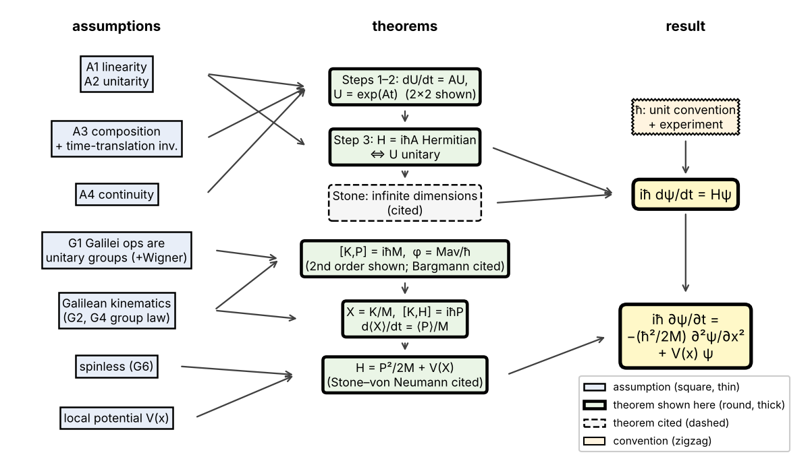

<!-- strategy: Spinning two-state matrices -->

Put a spin in a magnetic field and its state turns continuously; turn it for $t_1$ then for $t_2$ and you are where one turn of $t_1+t_2$ puts you. Linearity, unitarity, composition and continuity turn that into $i\hbar\dot\psi=H\psi$; Galilean invariance then says which $H$ a free particle has. Each step is labelled **[theorem]** (follows from what came before), **[assumption]** (put in by hand, motivated by experiment) or **[heuristic]** (true, full proof beyond this level).

## 1. Experiments

**Rabi resonance (1938) and pulsed spin flips.** Rabi's molecules with a magnetic moment crossed a static field $B_0$ and an oscillating field; he swept $B_0$ at fixed transit time and observed sharp, reproducible resonance dips in the beam. Later time-domain experiments (Torrey 1949 in NMR; trapped ions and atoms today) vary the pulse length $t$ and observe a flip fraction that changes smoothly with $t$, close to $\sin^2(\Omega t/2)$ on resonance ($\Omega$ set by the drive strength), with no jumps. This is continuity in time. (Composition is *consistent* with such data when the drive is phase-continuous across pulses and relaxation is negligible, but any deterministic evolution would pass that test; composition is an assumption below, not a measured fact.)

**Rauch's $4\pi$ neutron spin rotation (1975).** A neutron beam is split in a silicon interferometer; one path crosses a field that turns the spin by angle $\phi$. Observed: the output intensity oscillates in $\phi$ with period $4\pi$, not $2\pi$. The state vector, not only the probabilities, is what evolves, and it changes sign under a $2\pi$ turn.

**Colella–Overhauser–Werner (1975).** The same kind of interferometer, tilted so one path runs a height $\Delta z$ above the other. Observed: a fringe shift agreeing to about 1% with the phase $Mg\Delta z\,T/\hbar$, $T$ the transit time, $M$ the neutron mass (later versions found percent-level discrepancies, still studied). The phase of $\psi$ carries a mass; a classical wave has no such constant. Which mass, and why, is taken up in §4.

**Davisson–Germer (1927).** Electrons of energy $eV_0$ scattered from nickel peak where a wave of wavelength $\lambda=h/\sqrt{2m_e eV_0}$ would. Used in §4 to identify $M$.

*Sources:* Ramsey, *Molecular Beams*, ch. V (resonance method and transients); Rauch & Werner, *Neutron Interferometry* (spin rotation and gravity chapters); Sakurai & Napolitano, *Modern QM* 2nd ed., §2.7 (COW), §3.2 ($4\pi$ rotation), §5.5 (spin resonance); Feynman Lectures III, ch. 7, 10.

## 2. Classical candidates and the surviving model

A **classical magnetic needle** can point anywhere, so a Stern–Gerlach analyser would give a continuous spread; observed: two spots. And it has no state that changes sign at $2\pi$. A **classical wave** has no sign flip at $2\pi$, gives no single clicks, and has no mass in its phase (COW). Both ruled out.

Surviving model: a state is a vector $\psi$ (two complex components for spin-½; a function $\psi(x)$ for a particle on a line), probabilities are squared magnitudes, and evolution is a map $\psi(0)\mapsto U(t)\psi(0)$. Copenhagen-style, many-worlds and pilot-wave interpretations all use this same $U(t)$ (many-worlds and pilot-wave at all times, Copenhagen-style between measurements), so the derivation is neutral among them. Objective-collapse models (GRW, CSL) are different theories: they add a stochastic, nonlinear term that breaks both A1 and A2 below by a tiny amount, which experiments are testing.

## 3. Four assumptions to $i\hbar\dot\psi=H\psi$ (two-state case, every step)

Work with $2\times2$ matrices so every step can be multiplied out.

**A1 Linearity [assumption].** $U(t)$ is a matrix: superpositions evolve to superpositions (what interferometers test).

**A2 Unitarity [assumption].** $U^\dagger U=\mathbb 1$, $\dagger$ = conjugate-transpose; equivalent (you have seen this) to $\sum|c_i|^2$ staying $1$.

**A3 Composition [assumption].** $U(s)U(t)=U(s+t)$, $U(0)=\mathbb 1$. This includes time-translation invariance (the apparatus does not change in time); without it the law reads $U(t_2,t_1)U(t_1,t_0)=U(t_2,t_0)$ and $H$ may depend on $t$. (For a driven spin this holds in the frame rotating with the drive, within the rotating-wave approximation.)

**A4 Continuity [assumption; strengthened to differentiability: heuristic].** For matrices a continuous one-parameter group is automatically differentiable (theorem, not proved here); I use differentiability directly.

**Step 1 [theorem].** Define $A=\dfrac{dU}{dt}\Big|_{0}$. For any $t$,
$$\frac{dU}{dt}=\lim_{\varepsilon\to0}\frac{U(t+\varepsilon)-U(t)}{\varepsilon}=\lim_{\varepsilon\to0}\frac{U(\varepsilon)U(t)-U(0)U(t)}{\varepsilon}=A\,U(t),$$
using A3 twice. The rate of change of $U$ is a fixed matrix times $U$: first order in time, because composition makes the future depend on the present state only.

**Step 2 [theorem].** $U(t)=e^{At}\equiv\sum_{n\ge0}(At)^n/n!$: differentiate termwise to get $Ae^{At}$, and $e^{0}=\mathbb 1$. Uniqueness: if $\dot V=AV$, $V(0)=\mathbb 1$, then $\frac{d}{dt}(e^{-At}V)=-Ae^{-At}V+e^{-At}AV=0$ ($A$ commutes with $e^{-At}$), so $e^{-At}V=\mathbb 1$.

**Step 3 [theorem].** Define $H\equiv i\hbar A$. Differentiating A2 at $0$: $A^\dagger+A=0$, i.e. $iH^\dagger/\hbar-iH/\hbar=0$, so $H^\dagger=H$. Converse: if $H^\dagger=H$, $\frac{d}{dt}(U^\dagger U)=U^\dagger(A^\dagger+A)U=0$, so $U^\dagger U=\mathbb 1$ for all $t$. Unitarity of $U$ $\Leftrightarrow$ Hermiticity of $H$.

**Step 4 [theorem].** With $\psi(t)=U(t)\psi(0)$: $\;i\hbar\,\dfrac{d\psi}{dt}=H\psi$, the Schrödinger equation in abstract form.

**$\hbar$ [assumption/convention].** Steps 1–4 hold with any nonzero constant in place of $\hbar$; choosing $\hbar$ measures $H$ in energy units. That the eigenvalues of $H$ are measured energies is fixed by experiment (stationary states $e^{-iEt/\hbar}$; Rabi resonance at $\hbar\omega$ = level spacing).

**Worked check: Larmor precession [theorem].** $H=\tfrac{\hbar\omega}{2}\sigma_z$, $\sigma_z=\mathrm{diag}(1,-1)$, $\sigma_z^2=\mathbb 1$, so the series splits into even and odd powers:
$$U(t)=\cos\tfrac{\omega t}{2}\,\mathbb 1-i\sin\tfrac{\omega t}{2}\,\sigma_z=\mathrm{diag}\big(e^{-i\omega t/2},e^{+i\omega t/2}\big).$$
From $\psi(0)=\tfrac1{\sqrt2}(1,1)$ (spin along $+x$): $\langle\sigma_x\rangle=2\,\mathrm{Re}(\psi_1^*\psi_2)=\cos\omega t$, $\langle\sigma_y\rangle=\sin\omega t$: precession about $z$ at $\omega$. At $\omega t=2\pi$ the direction is back but $\psi=-\psi(0)$: Rauch's sign flip; $\psi$ itself returns at $4\pi$.

**Beyond $2\times2$ [theorem, Stone, cited].** For $\psi(x)$, $U(t)$ is infinite-dimensional. Stone's theorem: every strongly continuous one-parameter unitary group is $e^{-iHt/\hbar}$ with $H$ self-adjoint, possibly unbounded and defined only on a dense set of functions.

*Sources:* Ballentine, *QM: A Modern Development*, §3.1–3.2; Sakurai & Napolitano §2.1; Weinberg, *Lectures on QM*, ch. 3 (sections on symmetries, space and time translation).

## 4. Galilean invariance fixes the free $H=P^2/2M$; $V(X)$ is then added

**G1 [assumption].** Translations by $a$, boosts by $v$, time shifts by $t$ act on $\psi$ as continuous one-parameter unitary groups: $e^{-iaP/\hbar}$, $e^{ivK/\hbar}$, $e^{-iHt/\hbar}$, with Hermitian generators $P$, $K$, $H$ (Stone). Why unitary: a moved preparation gives the same probabilities, moved; Wigner's theorem then allows unitary or antiunitary, and composition excludes antiunitary: $U(t)=U(t/2)^2$, and the square of an antiunitary map is unitary.

**G2 [assumption, then theorem].** Classically "translate then boost" and "boost then translate" give the same motion. *Assumption:* on states the two products then agree on every ray: $W\equiv e^{ivK/\hbar}e^{-iaP/\hbar}$ and $W'\equiv e^{-iaP/\hbar}e^{ivK/\hbar}$ satisfy $W\psi=e^{i\alpha(\psi)}W'\psi$, with $\alpha$ smooth in $a,v$. *Theorem:* $\alpha$ cannot depend on $\psi$. Take linearly independent $\psi_1,\psi_2$; by linearity $W(\psi_1+\psi_2)=e^{i\alpha_1}W'\psi_1+e^{i\alpha_2}W'\psi_2$, but also $=e^{i\alpha_{12}}(W'\psi_1+W'\psi_2)$. Subtracting, $(e^{i\alpha_1}-e^{i\alpha_{12}})W'\psi_1+(e^{i\alpha_2}-e^{i\alpha_{12}})W'\psi_2=0$; $W'$ is invertible, so $W'\psi_1,W'\psi_2$ are independent and both coefficients vanish: $\alpha_1=\alpha_2=\alpha_{12}$. So $W=e^{i\varphi(a,v)}W'$ with a number $\varphi$, $\varphi(a,0)=\varphi(0,v)=0$, hence $\varphi=\lambda av+$ higher order. Expand both sides to second order with $B=ivK/\hbar$, $C=-iaP/\hbar$:
$$1+B+C+\tfrac12B^2+BC+\tfrac12C^2=(1+i\lambda av)(1+C+B+\tfrac12C^2+CB+\tfrac12B^2)+\dots$$
The $av$ terms give $BC-CB=i\lambda av\,\mathbb 1$, i.e. $\frac{av}{\hbar^2}[K,P]=i\lambda av\,\mathbb 1$. Define $M\equiv\lambda\hbar$:
$$[K,P]=i\hbar M\,\mathbb 1,\qquad \varphi=\frac{Mav}{\hbar}\ \text{(dimensionless: }M\cdot\text{length}\cdot\text{velocity}/\hbar).$$
$M$ has units of mass. Shifting $K\to K+\kappa\mathbb 1$, $P\to P+\pi\mathbb 1$ leaves the commutator unchanged, so $M$ cannot be removed: it is the "central charge" (Bargmann 1954; that no other phase structure is possible is **[theorem, cited]**). **[theorem, cited]** With $M=0$ there is no position operator, hence no localizable particle states (Inönü & Wigner 1952), so $M\ne0$ for a particle.

**G3 [definition, then theorem].** Define $X\equiv K/M$; then $[X,P]=i\hbar\,\mathbb 1$. In the representation where $X$ multiplies by $x$, $P=-i\hbar\,d/dx$ satisfies this; **[theorem, Stone–von Neumann, cited]** for an irreducible representation (one spinless particle, no internal degrees of freedom) of the exponentiated relation, any other choice is unitarily equivalent. Why $X$ deserves the name *position* is settled in G5.

**G4 [assumption + theorem].** Galilean kinematics: "boost by $v$, then wait $t$" equals "wait $t$, then boost, then translate by $vt$" (check on a classical path $x_0+ut$: both give $x_0+(u+v)t$). On states, as in G2, up to a phase $\chi(v,t)$, smooth, with $\chi(0,t)=\chi(v,0)=0$, so $\chi=\mu vt+\dots$:
$$e^{-iHt/\hbar}e^{ivK/\hbar}=e^{i\chi}\,e^{-ivtP/\hbar}e^{ivK/\hbar}e^{-iHt/\hbar}.$$
Expand each factor to first order in its parameter: $e^{-iHt/\hbar}\approx1-\frac{it}{\hbar}H$, $e^{ivK/\hbar}\approx1+\frac{iv}{\hbar}K$, $e^{-ivtP/\hbar}\approx1-\frac{ivt}{\hbar}P$, $e^{i\chi}\approx1+i\mu vt$. Left side: $1-\frac{it}{\hbar}H+\frac{iv}{\hbar}K+\frac{vt}{\hbar^2}HK$. Right side: $1+i\mu vt-\frac{ivt}{\hbar}P+\frac{iv}{\hbar}K-\frac{it}{\hbar}H+\frac{vt}{\hbar^2}KH+\dots$ (terms of order $v^2$, $t^2$ dropped). The $vt$ terms: $\frac{vt}{\hbar^2}HK=-\frac{ivt}{\hbar}P+\frac{vt}{\hbar^2}KH+i\mu vt$. So $[H,K]=-i\hbar P+i\hbar^2\mu\,\mathbb 1$. Redefine $P\to P-\hbar\mu\,\mathbb 1$ (this leaves $[K,P]$ unchanged): $[K,H]=i\hbar P$.

**G5 [theorem].** From Step 4, $\frac{d}{dt}\langle X\rangle=\frac{i}{\hbar}\langle[H,X]\rangle$ (differentiate $\psi^\dagger X\psi$). With G4, $[X,H]=[K,H]/M=i\hbar P/M$, so $\frac{d}{dt}\langle X\rangle=\langle P\rangle/M$: $K/M$ is the operator whose mean moves at (momentum)/$M$, which is what "position" and "mass" mean in kinematics. Also $\big[X,\tfrac{P^2}{2M}\big]=\tfrac1{2M}([X,P]P+P[X,P])=\tfrac{i\hbar P}{M}$. So $[X,\,H-P^2/2M]=0$.

**G6 [assumption: no internal degrees of freedom; then theorem, cited].** For a spinless particle every operator commuting with $X$ is a function of $X$ ($X$ generates a maximal commuting set). Hence $H=P^2/2M+V(X)$. Translation invariance of a *free* particle, $[P,H]=0$, forces $V$ constant (set $0$). A nonconstant $V(x)$ is an **[assumption]**: an external *scalar* local potential, outside the Galilei group. Keeping $[K,H]=i\hbar P$ (velocity $=P/M$) inside the field is what excludes a vector potential; the general external-field form is $(P-A(X))^2/2M+W(X)$.
$$i\hbar\,\frac{\partial\psi}{\partial t}=-\frac{\hbar^2}{2M}\frac{\partial^2\psi}{\partial x^2}+V(x)\psi.$$

**Checks.** *Davisson–Germer [theorem]:* $\psi=e^{i(kx-\omega t)}$ solves the free equation iff $\hbar\omega=\hbar^2k^2/2M$. The measured $\lambda=h/\sqrt{2m_e eV_0}$ with $E=eV_0$ gives $M=m_e$: the central charge is the inertial mass. *COW [heuristic]:* in the lab, a potential $V=M_g gz$ (a G6-type assumption, $M_g$ the gravitational mass) gives the phase $M_g g\Delta z\,T/\hbar$; the inertial mass sits inside $T$. Equating $M_g$ with the boost central charge $M$ is the equivalence principle, an extra assumption that COW tests; the Galilei group does not supply it, and a uniformly accelerated frame change is not a Galilei transformation, so the G2 phase alone does not give this result.

*Sources:* Ballentine §3.3–3.4 (Galilei algebra, central charge, $H=P^2/2M+V$, external fields); Weinberg ch. 3 (Galilean invariance section); Sakurai & Napolitano §1.6–1.7, §2.7; Inönü & Wigner, Nuovo Cimento 9, 705 (1952); Greenberger & Overhauser, Rev. Mod. Phys. 51, 43 (1979).

## 5. Status summary and how the pieces relate

| Step | Status |
|---|---|
| Linearity, unitarity, composition, continuity, time-translation invariance | assumption |
| $\dot U=AU$, $U=e^{At}$, $H^\dagger=H\Leftrightarrow$ unitary | theorem (shown) |
| Infinite dimensions | theorem (Stone, cited) |
| $\hbar$, energy units | convention / experiment |
| Galilei operations unitary groups; commuting on rays | assumption (+Wigner) |
| $[K,P]=i\hbar M$, $\varphi=Mav/\hbar$ | theorem (shown to second order) |
| $X=K/M$ is position; $[K,H]=i\hbar P$ | definition + theorem; kinematic assumption |
| $H=P^2/2M$ | theorem given spinless |
| $V(x)$ | assumption (scalar local potential) |
| COW mass = central charge | equivalence principle (assumption, tested) |

Spin and particle use the *same* theorem (Stone) but are not the same case: for the particle $H$ is unbounded and defined on a dense domain, which is the real content of the infinite-dimensional version. What differs physically is which group then fixes $H$ (rotations for spin, Galilei for a particle). Domain: this is non-relativistic; replacing Galilei by Poincaré leads to Wigner's classification of particles by mass and spin, with Klein–Gordon and Dirac as the covariant single-particle equations for spin 0 and ½ (with the usual single-particle caveats).

**Check yourself:** In Step 3, what goes wrong if you drop the $i$ and write $A=-H/\hbar$ with $H$ Hermitian; what does $U(t)$ do to the norm of $\psi$ then?
